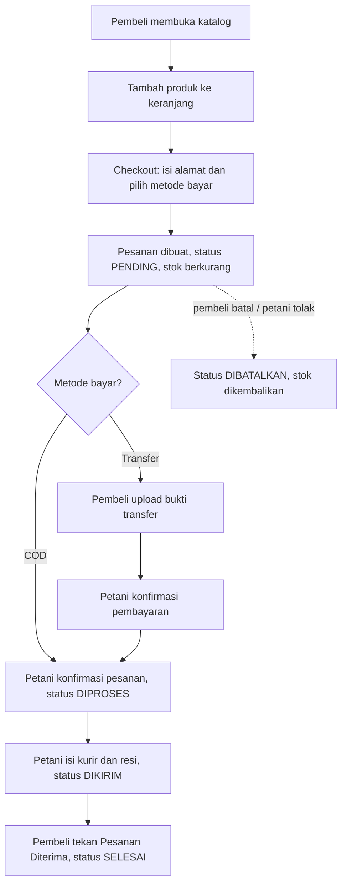
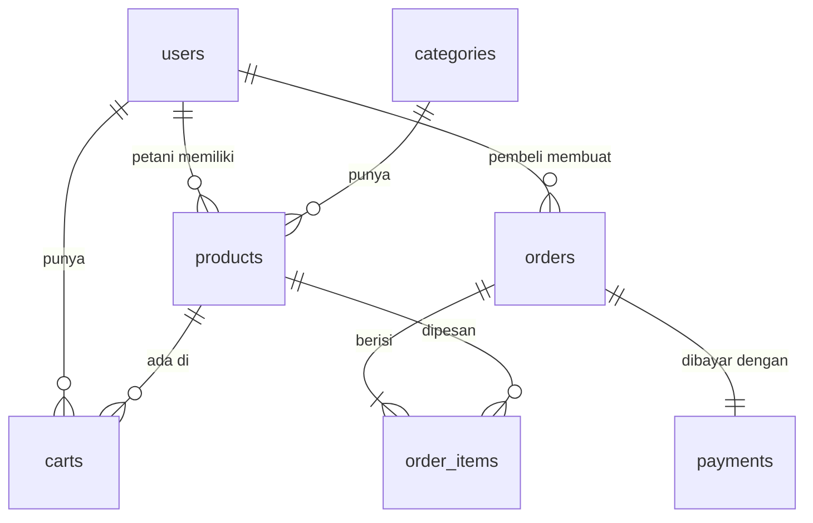

# AgriTani

Marketplace hasil pertanian sederhana berbasis **Laravel 12** dan **MySQL**. Petani menjual hasil panen, pembeli memesan dan membayar, admin mengawasi. Proyek akhir kelompok (4 anggota).

## Tujuan proyek
1. Mempertemukan **petani langsung dengan pembeli** tanpa perantara.
2. Memberi petani alat berjualan: kelola produk, terima pesanan, konfirmasi pembayaran, dan kirim barang.
3. Memberi **admin** kendali dasar atas platform: akun petani, kategori, dan pemantauan pesanan.

## Tiga peran pengguna
| Peran | Yang dilakukan |
|---|---|
| **Pembeli** | Lihat katalog, belanja lewat keranjang, checkout, bayar, lacak pesanan, konfirmasi barang diterima |
| **Petani** | Kelola produk, terima pesanan, konfirmasi pembayaran, isi resi pengiriman |
| **Admin** | Aktifkan/nonaktifkan petani, kelola kategori, pantau semua pesanan |

Petani yang baru mendaftar berstatus **nonaktif** sampai admin mengaktifkannya. Pembeli langsung aktif.

## Alur kerja web


Status pesanan:

| Status | Arti | Siapa yang mengubah |
|---|---|---|
| `pending` | Pesanan baru, menunggu petani | Sistem saat checkout |
| `diproses` | Petani menerima dan mengemas | Petani |
| `dikirim` | Resi sudah diisi | Petani |
| `selesai` | Barang diterima | Pembeli |
| `dibatalkan` | Dibatalkan atau ditolak, stok kembali | Pembeli atau petani (hanya dari `pending`) |

Aturan yang perlu dijelaskan saat presentasi:
- Satu keranjang berisi produk dari beberapa petani akan **dipecah menjadi satu pesanan per petani**.
- Stok dikurangi saat checkout. Kalau stok kurang, seluruh checkout dibatalkan (satu transaksi database).
- Transfer harus dikonfirmasi pembayarannya dulu sebelum pesanan bisa diproses. COD bisa langsung diproses.
- Ongkos kirim tetap per pesanan, diatur di `.env` (`AGRITANI_SHIPPING_COST`).

## Fitur
**Semua peran:** login, register, **lupa password** (tautan reset lewat email), dan **ubah password** di halaman profil.

**Pembeli:** katalog dengan pencarian, filter kategori, dan urut harga · keranjang · checkout (transfer/COD) · upload bukti transfer · daftar dan detail pesanan · batalkan pesanan · konfirmasi diterima · edit profil dan ubah password.

**Petani:** tambah/ubah/aktif-nonaktifkan produk (dengan foto) · pesanan masuk (konfirmasi/tolak) · konfirmasi atau tolak bukti pembayaran · isi resi pengiriman · dashboard (jumlah produk, terjual, pendapatan, stok menipis).

**Admin:** dashboard (grafik pesanan 7 hari) · kelola petani · kelola kategori · daftar dan detail semua pesanan.

## Struktur database (6 tabel inti)


| Tabel | Isi utama |
|---|---|
| `users` | name, email, password, **role** (admin/petani/pembeli), phone, address, photo, is_active |
| `categories` | name, slug |
| `products` | user_id (petani), category_id, name, price, stock, unit, weight, image, is_active |
| `carts` | user_id, product_id, quantity |
| `orders` | user_id (pembeli), total_price, shipping_cost, status, shipping_address, courier, tracking_number |
| `order_items` | order_id, product_id, quantity, price, subtotal |
| `payments` | order_id, amount, method (transfer/cod), status, proof_image |

(`cache`, `jobs`, `sessions`, dan `password_reset_tokens` adalah tabel bawaan Laravel.)

## Pembagian tugas (4 anggota)
Setiap anggota punya **satu file route**, **controller**, **view**, dan **folder test** sendiri. Rincian file ada di [PEMBAGIAN_TUGAS.md](PEMBAGIAN_TUGAS.md).

| Anggota | Modul | Yang dikerjakan | Tabel | File route | Folder test |
|---|---|---|---|---|---|
| **1** | Akun & Admin | Login, register, logout, lupa password, ubah password, hak akses per peran, profil, dashboard admin, kelola petani, lihat pesanan (admin) | `users` | `1-akun-admin.php` | `AkunAdmin` |
| **2** | Produk & Katalog | Katalog publik, produk milik petani, kategori | `categories`, `products` | `2-produk.php` | `Produk` |
| **3** | Belanja (sisi pembeli) | Keranjang, checkout, pesanan pembeli, upload bukti, batal, konfirmasi diterima | `carts`, `orders`, `order_items` | `3-belanja.php` | `Belanja` |
| **4** | Pesanan Masuk (sisi petani) | Pesanan masuk, konfirmasi pembayaran, resi pengiriman, dashboard petani | `payments` | `4-pesanan-masuk.php` | `PesananMasuk` |

Urutan pengerjaan yang disarankan (karena foreign key): **1 → 2 → 3 → 4**. Anggota 3 butuh produk dari anggota 2, dan anggota 4 butuh pesanan dari anggota 3.

## Kebutuhan
- PHP 8.3+ dan Composer
- MySQL (disarankan Laragon di Windows)

Tidak perlu Node.js/npm. Tampilan memakai Bootstrap 5 yang sudah disertakan di `public/vendor/bootstrap/`, jadi tidak ada langkah build dan berjalan offline.

> **Peringatan Node.js:** proyek ini **tidak memakai Node.js**. Jangan menjalankan `npm install`, `npm run dev`, atau `npm run build` karena `package.json` sudah dihapus. Versi Node apa pun (termasuk 18) tidak berpengaruh. Jika muncul error `Vite manifest not found`, berarti kode Anda masih versi lama: jalankan `git pull`, lalu `php artisan view:clear`.

## Setup
```bash
# 1. Clone dan masuk ke folder proyek
git clone https://github.com/mochammadilham55/agritani-example.git
cd agritani-example

# 2. Pasang dependensi
composer install

# 3. Siapkan environment
cp .env.example .env
php artisan key:generate
```

4. Buat database kosong di MySQL, misalnya `agritani`, lalu ubah bagian database di `.env`
   (secara bawaan `.env.example` memakai SQLite, jadi baris ini harus diganti):

```env
DB_CONNECTION=mysql
DB_HOST=127.0.0.1
DB_PORT=3306
DB_DATABASE=agritani
DB_USERNAME=root
DB_PASSWORD=
```

5. Jalankan migration, seeder, dan tautan storage:

```bash
php artisan migrate --seed
php artisan storage:link
```

6. Jalankan aplikasi:

```bash
php artisan serve
```

Buka http://127.0.0.1:8000.

`storage:link` wajib dijalankan supaya foto produk dan bukti transfer tampil.

> **Sudah pernah setup versi lama?** Skema tabel berubah (tabel `shipments` dan `reviews` dihapus, kolom resi pindah ke `orders`). Jalankan `php artisan migrate:fresh --seed` untuk membangun ulang database. Perintah ini **menghapus semua data** di database tersebut.

## Akun uji
Semua akun memakai password `password`.

| Peran | Email |
|---|---|
| Admin | admin@agritani.test |
| Petani | petani@agritani.test |
| Petani 2 | petani2@agritani.test |
| Pembeli | pembeli@agritani.test |

Hanya untuk pengembangan lokal. Ganti atau hapus akun ini sebelum aplikasi dipasang di server sungguhan.

## Data contoh (opsional)
Untuk mengisi dashboard dengan pesanan dalam berbagai status, jalankan:

```bash
php artisan db:seed --class=DemoSeeder
```

Seeder ini aman diulang dan dilewati jika pesanan sudah ada.

## Lupa password saat demo
Secara bawaan `MAIL_MAILER=log` di `.env`, jadi email **tidak dikirim sungguhan**. Tautan reset ditulis ke `storage/logs/laravel.log`:

1. Di halaman login klik **Lupa password?**, masukkan email akun, lalu kirim.
2. Buka `storage/logs/laravel.log`, cari baris terakhir yang memuat `/reset-password/`, lalu salin URL-nya ke browser.
3. Isi password baru dan login kembali. Tautan hanya berlaku sekali dan kedaluwarsa dalam 60 menit.

Untuk mengirim email sungguhan, isi `MAIL_MAILER=smtp` dan data SMTP di `.env` (misalnya Mailtrap atau Gmail).

## Skenario demo untuk presentasi
1. Login **pembeli** → buka katalog → tambah dua produk dari petani berbeda ke keranjang → checkout dengan **transfer**. Tunjukkan bahwa pesanan terpecah jadi dua.
2. Buka **Pesanan Saya** → upload bukti transfer.
3. Login **petani** → menu **Pembayaran** → konfirmasi → menu **Pesanan Masuk** → konfirmasi pesanan.
4. Menu **Pengiriman** → isi kurir dan resi → status berubah ke Dikirim.
5. Kembali ke **pembeli** → lihat resi → tekan **Pesanan Diterima** → status Selesai.
6. Login **admin** → tunjukkan dashboard, daftar pesanan, kelola petani, dan kategori.

## Menjalankan test
Test memakai SQLite in-memory, jadi tidak menyentuh database MySQL Anda.

```bash
php artisan test                           # semua modul
php artisan test tests/Feature/Belanja     # satu modul saja
```

Folder test: `AkunAdmin`, `Produk`, `Belanja`, `PesananMasuk`, dan `Core` (komponen bersama).

## Konfigurasi
| Variabel `.env` | Fungsi | Bawaan |
|---|---|---|
| `AGRITANI_SHIPPING_COST` | Ongkos kirim tetap per pesanan (Rp) | 10000 |

## Struktur route
`routes/web.php` hanya memuat login, register, dan logout. Route fitur dipisah per anggota di `routes/modules/`:
`1-akun-admin.php`, `2-produk.php`, `3-belanja.php`, `4-pesanan-masuk.php`.

## Panduan Git untuk Tim

Panduan ini untuk anggota yang baru memakai Git. Ikuti urutannya, jangan dilompati.

### Pengaturan awal (sekali saja)
```bash
git config --global user.name "Nama Anda"
git config --global user.email "email-github-anda@contoh.com"
```
Pakai email yang sama dengan akun GitHub Anda supaya kontribusi tercatat atas nama Anda.

### Alur kerja harian
```bash
# 1. Ambil perubahan terbaru dari main
git checkout main
git pull

# 2. Buat branch baru untuk satu fitur/perbaikan
git checkout -b fitur/nama-singkat        # contoh: fitur/filter-produk

# 3. Kerjakan kode, lalu cek apa yang berubah
git status
git diff

# 4. Simpan perubahan
git add app/Http/Controllers/CatalogController.php   # tambahkan file yang Anda ubah
git commit -m "Tambah filter harga di halaman katalog"

# 5. Kirim branch Anda (bukan main)
git push -u origin fitur/nama-singkat
```
Setelah itu buka GitHub dan buat **Pull Request** dari branch Anda ke `main`. Minta satu anggota lain untuk me-review sebelum di-merge.

### Wajib sebelum push
1. **Jalankan semua test dan pastikan hijau:** `php artisan test`
2. **Periksa file yang akan dikirim:** `git status`. Pastikan tidak ada `.env`, `vendor/`, atau file foto/unggahan.
3. **Pastikan hanya file modul Anda yang berubah.** Kalau perlu mengubah file modul orang lain, beri tahu pemiliknya (lihat [PEMBAGIAN_TUGAS.md](PEMBAGIAN_TUGAS.md)).
4. **Ambil perubahan terbaru dulu:** `git pull origin main`, selesaikan bentrokan jika ada, lalu jalankan test lagi.
5. **Cek pesan commit** supaya jelas dan singkat, dalam Bahasa Indonesia, dengan kata kerja di depan ("Tambah ...", "Perbaiki ...", "Hapus ...").

### Aturan penting
- **Jangan push langsung ke `main`.** Selalu lewat branch dan Pull Request.
- **Satu branch untuk satu fitur.** Jangan mencampur beberapa pekerjaan dalam satu branch.
- **Jangan pernah commit `.env`.** File itu berisi password dan kunci aplikasi. Kalau terlanjur ter-push, beri tahu ketua tim segera karena kuncinya harus diganti.
- **Jangan memakai `git push --force`** dan jangan menulis ulang history yang sudah di-push. Ini bisa menghapus pekerjaan anggota lain.
- **Jangan memakai `git add .` secara buta.** Gunakan `git status` dulu, atau tambahkan file satu per satu.
- **Jangan mengedit migration yang sudah di-merge.** Buat migration baru: `php artisan make:migration nama_perubahan`.
- **Jangan mengubah file inti** (`routes/web.php`, layout, `RoleMiddleware`, `app.css`, dan sejenisnya) tanpa diskusi. Daftarnya ada di `PEMBAGIAN_TUGAS.md`.
- **Jangan menyimpan password, token, atau kunci API** di kode. Taruh di `.env`.
- **Commit sering dan kecil**, lebih baik beberapa commit kecil daripada satu commit besar di akhir.

### Kalau terjadi masalah
| Masalah | Yang dilakukan |
|---|---|
| Salah menulis pesan commit terakhir (belum di-push) | `git commit --amend -m "pesan baru"` |
| Ingin membatalkan perubahan satu file yang belum di-commit | `git restore nama-file` (perubahan di file itu hilang permanen) |
| Terlanjur commit di `main` (belum di-push) | Jangan push. Minta bantuan ketua tim |
| `git pull` menampilkan **CONFLICT** | Buka file yang ditandai, pilih isi yang benar, hapus tanda `<<<<<<<`, `=======`, `>>>>>>>`, lalu `git add` dan `git commit`. Kalau ragu, tanya dulu |
| Bingung dengan kondisi repo | Jalankan `git status` dan `git log --oneline -5`, lalu tanya tim. Jangan menebak dengan `reset --hard` |

### Untuk ketua tim (pengaturan GitHub, sekali saja)
Di GitHub: **Settings → Branches → Add branch ruleset** untuk `main`, lalu aktifkan *Require a pull request before merging* dan *Block force pushes*. Dengan itu aturan "jangan push ke main" ditegakkan otomatis, bukan hanya himbauan.

## Lisensi
Proyek ini dibangun di atas [Laravel](https://laravel.com), yang berlisensi [MIT](https://opensource.org/licenses/MIT).
