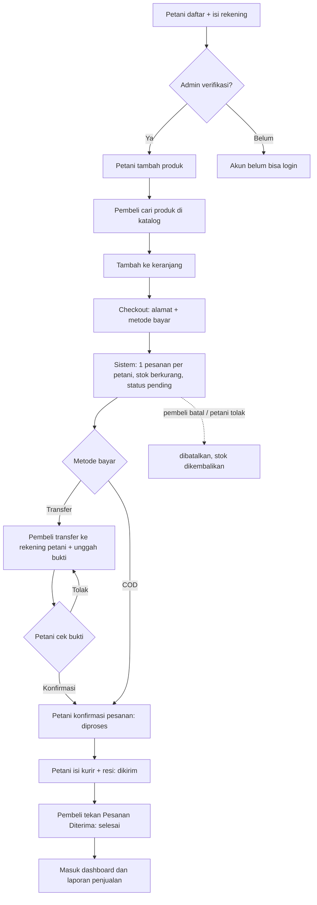
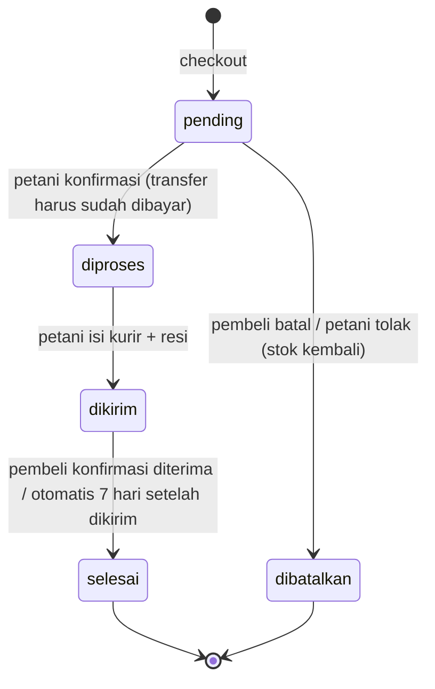
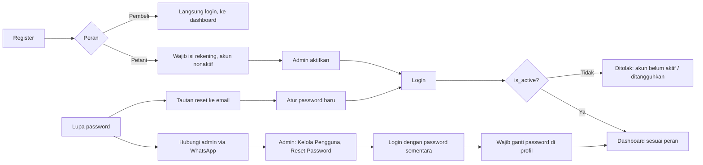
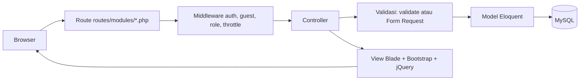
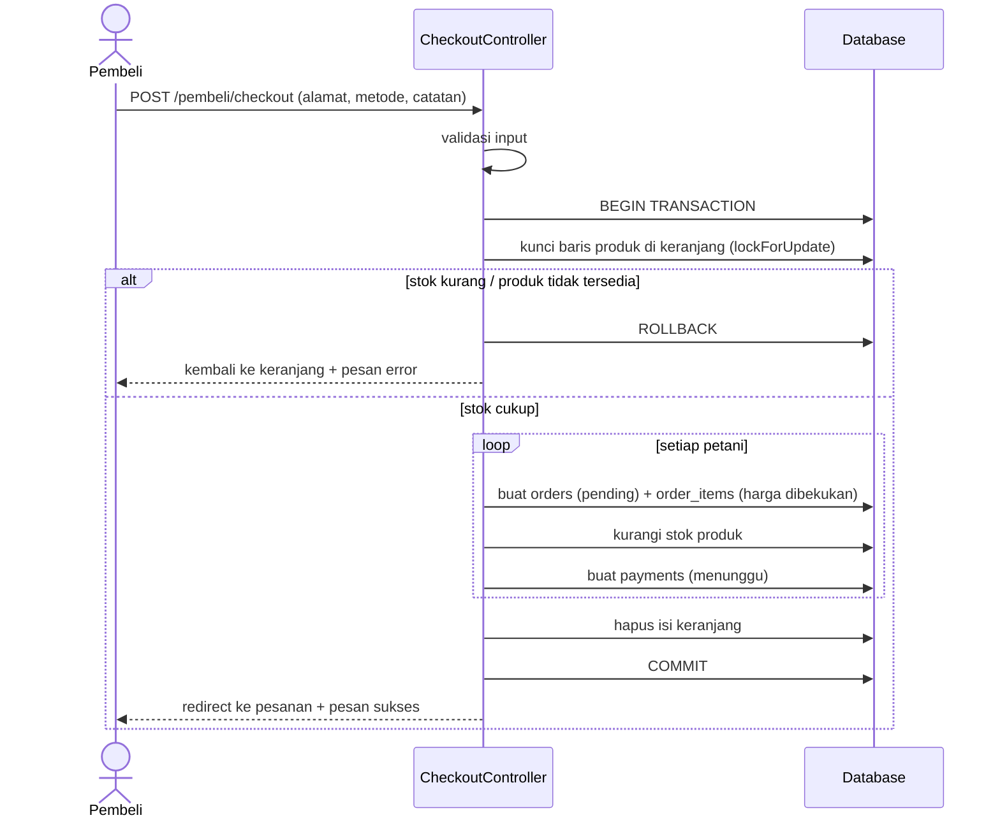
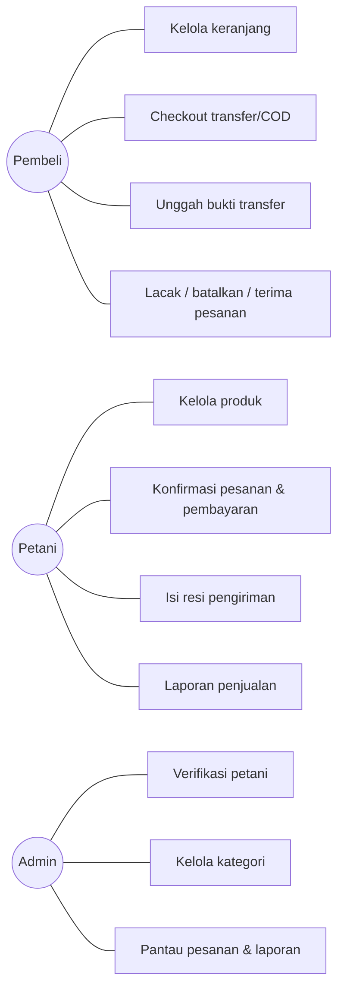
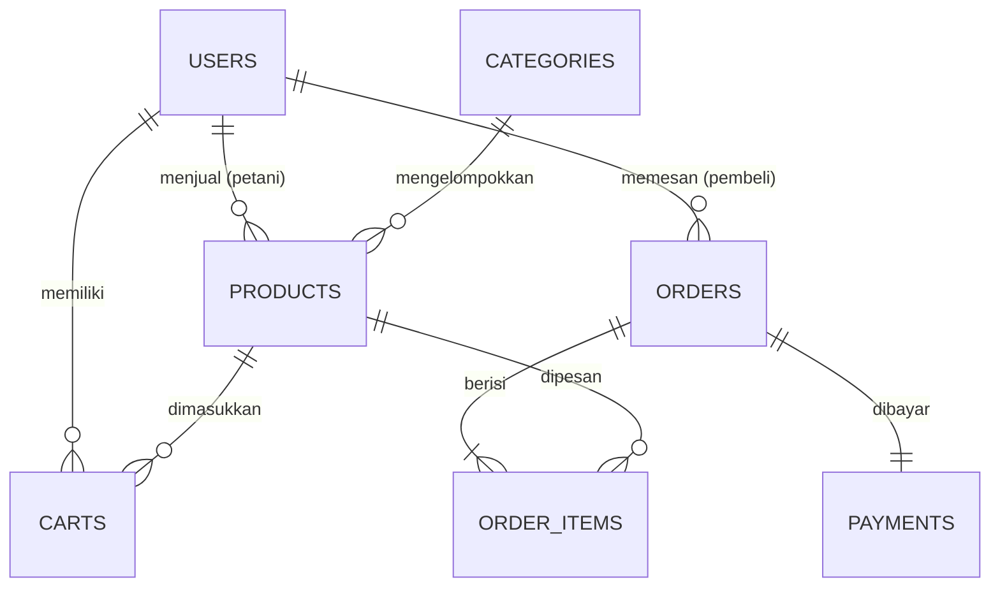

# PRD dan Alur Sistem — AgriTani (Marketplace Hasil Pertanian)

Dokumen ini disusun dari kode repository `https://github.com/mochammadilham55/agritani-example` (branch `main`, 17 November 2026). Isinya menggambarkan aplikasi **sebagaimana sudah dibuat**, bukan rencana. Setiap fakta bisa dicek ke file yang disebutkan.

> **Petunjuk untuk AI yang membaca dokumen ini.**
> 1. Dokumen ini dipakai untuk menyusun **laporan project akhir** matakuliah. Gunakan hanya fakta di sini. Jangan menambah fitur, angka, tabel, atau hasil pengujian yang tidak tertulis.
> 2. Yang belum ada harus ditulis sebagai placeholder dalam kurung siku: `[Nama Anggota 1]`, `[NIM]`, `[Logo UNEJ]`, `[Referensi]`.
> 3. Screenshot sudah tersedia (daftar di bagian 16). Sebut nomor dan nama filenya pada bagian hasil implementasi, jangan mendeskripsikan isi yang tidak tertulis di sini.
> 4. Struktur laporan yang diminta ada di bagian 17. Gunakan bahasa Indonesia baku.

---

## Daftar isi
1. Ringkasan proyek
2. Latar belakang, rumusan masalah, tujuan, batasan
3. Pengguna dan hak akses
4. Kebutuhan fungsional
5. Aturan bisnis
6. **Alur sistem** (alur utama, alur per peran, alur status, alur teknis)
7. Use case
8. Model data dan ERD
9. Peta route
10. Arsitektur aplikasi
11. Kebutuhan non-fungsional
12. Teknologi
13. Pemetaan materi perkuliahan
14. Pengujian
15. Pembagian modul anggota
16. Daftar screenshot
17. Struktur laporan yang diminta
18. Cara menjalankan dan akun uji

---

## 1. Ringkasan proyek

| Item | Isi |
| --- | --- |
| Nama aplikasi | AgriTani |
| Jenis | Aplikasi web marketplace hasil pertanian |
| Matakuliah | Pemrograman Berbasis Website |
| Program studi | Informatika, Fakultas Ilmu Komputer, Universitas Jember |
| Tahun ajaran | Gasal 2026/2027 |
| Tim | 4 mahasiswa, tiap anggota memegang satu modul penuh |
| Teknologi inti | Laravel 12, PHP 8.3, MySQL, Blade, Bootstrap 5.3.3, jQuery 3.7.1 |
| Status | Semua fitur di dokumen ini sudah berjalan. 89 tes otomatis lolos |
| Repository | `https://github.com/mochammadilham55/agritani-example` |

AgriTani mempertemukan **petani** yang menjual hasil tani dengan **pembeli**, diawasi oleh **admin**. Petani mengelola produk, pesanan, pembayaran, pengiriman, dan laporan penjualan. Pembeli mencari produk, berbelanja lewat keranjang, membayar dengan transfer atau COD, dan memantau pesanan sampai diterima.

## 2. Latar belakang, rumusan masalah, tujuan, batasan

### 2.1 Latar belakang
- Petani kecil umumnya menjual lewat tengkulak atau pasar, sehingga harga ditentukan pihak lain dan jangkauan pembeli terbatas.
- Pencatatan stok, pesanan, dan penjualan masih manual sehingga mudah salah dan sulit direkap.
- Pembeli sulit membandingkan produk dan harga dari beberapa petani dalam satu tempat, dan sulit mengetahui status pesanannya.

### 2.2 Rumusan masalah
1. Bagaimana petani dapat memasarkan produk serta mengelola stok dan pesanan masuk secara online?
2. Bagaimana pembeli dapat mencari produk, berbelanja, membayar, dan memantau status pesanan?
3. Bagaimana admin dapat memverifikasi petani, mengelola kategori, dan memantau seluruh transaksi?
4. Bagaimana data penjualan disajikan sebagai laporan yang dapat difilter, dicetak, dan diunduh?
5. Bagaimana hak akses tiap peran dibatasi agar pengguna hanya mengelola datanya sendiri?

### 2.3 Tujuan
1. Membangun etalase dan alat kelola pesanan untuk petani.
2. Menyediakan alur belanja lengkap untuk pembeli: katalog, keranjang, checkout, pembayaran, pelacakan.
3. Menyediakan fitur pengawasan untuk admin: verifikasi petani, kategori, pesanan, laporan.
4. Menyediakan laporan penjualan dengan filter, cetak, dan ekspor CSV.
5. Menerapkan seluruh materi perkuliahan Pemrograman Berbasis Website dalam satu aplikasi.

### 2.4 Batasan project
- Tiga peran: pembeli, petani, admin.
- 7 tabel utama: `users`, `categories`, `products`, `carts`, `orders`, `order_items`, `payments`.
- Pembayaran: transfer bank manual (pembeli mengunggah bukti, petani mengonfirmasi) dan COD. Tidak ada payment gateway.
- Ongkos kirim tetap per pesanan (`AGRITANI_SHIPPING_COST`, bawaan Rp 10.000), tidak dihitung dari jarak atau berat.
- Tidak ada ulasan, chat, atau notifikasi email/WhatsApp. Email lupa password pada mode pengembangan dicatat ke log.
- Laporan yang tersedia hanya laporan penjualan (petani dan admin). Ekspor berupa CSV, belum PDF.
- Aplikasi dijalankan lokal, belum di-deploy.

## 3. Pengguna dan hak akses

| Peran | Cara mendapat akun | Hak akses utama |
| --- | --- | --- |
| Pengunjung (belum login) | — | Melihat katalog dan detail produk, mendaftar, login, lupa password |
| Pembeli | Daftar sendiri, langsung aktif | Keranjang, checkout, pesanan saya, unggah bukti transfer, batalkan, konfirmasi diterima, profil |
| Petani | Daftar sendiri + wajib isi rekening bank. Akun **tidak aktif** sampai diverifikasi admin | Produk (tambah/ubah/aktif-nonaktif), pesanan masuk, pembayaran, pengiriman, laporan penjualan miliknya, profil + rekening |
| Admin | Dibuat lewat seeder | Dashboard statistik, verifikasi/tangguhkan petani, CRUD kategori, semua pesanan, laporan seluruh toko, profil |

Pembatasan dilakukan oleh middleware `role` (`app/Http/Middleware/RoleMiddleware.php`). Akses ke halaman peran lain menghasilkan **403**. Membuka data milik petani lain menghasilkan **404**. Akun yang ditangguhkan otomatis di-logout.

## 4. Kebutuhan fungsional

### 4.1 Modul 1 — Akun & Admin
| ID | Fitur | Kriteria |
| --- | --- | --- |
| F-1.1 | Register | Nama, email unik, no. HP opsional, password min. 8 karakter + konfirmasi. Pilih peran pembeli/petani. Petani wajib mengisi nama bank, nomor rekening (angka 6–30 digit), dan atas nama |
| F-1.2 | Login / logout | Diarahkan ke dashboard sesuai peran. Akun belum aktif ditolak dengan pesan |
| F-1.3 | Lupa password | Kirim tautan reset ke email, dibatasi 6 permintaan per menit. Atur ulang password lewat tautan |
| F-1.4 | Profil | Ubah nama, email, no. HP, alamat, foto. Petani juga mengubah rekening bank (wajib) |
| F-1.5 | Ubah password | Wajib mengisi password saat ini |
| F-1.10 | Hubungi admin via WhatsApp | Tombol di halaman lupa password dan login membuka `wa.me/<nomor admin>` dengan pesan otomatis berisi email. Nomor diatur di `.env` (`AGRITANI_ADMIN_WHATSAPP`); kosong = tombol disembunyikan |
| F-1.11 | Kelola pengguna & reset password oleh admin | Daftar semua pembeli dan petani (cari nama/email/no. HP, filter peran). Tombol Reset Password membuat password sementara (format `Tani-XXXX9999`) yang tampil sekali ke admin. Akun admin tidak bisa direset |
| F-1.12 | Wajib ganti password sementara | Pengguna dengan password sementara hanya bisa membuka halaman profil dan logout sampai password diganti (middleware `EnsurePasswordChanged`) |
| F-1.6 | Dashboard admin | Total pengguna, produk aktif, pesanan hari ini, pendapatan, grafik pesanan 7 hari, pesanan terbaru |
| F-1.7 | Kelola petani | Daftar petani dengan pencarian dan filter status. Tombol aktifkan / tangguhkan |
| F-1.8 | Semua pesanan | Daftar dan detail seluruh pesanan, pencarian dan filter status |
| F-1.9 | Laporan penjualan admin | Seluruh toko (lihat F-4.7) |

### 4.2 Modul 2 — Produk & Katalog
| ID | Fitur | Kriteria |
| --- | --- | --- |
| F-2.1 | Katalog | Hanya produk aktif milik petani aktif. Cari nama, filter kategori, urut harga, pagination |
| F-2.2 | Detail produk | Harga, satuan, stok, berat, deskripsi, nama petani, produk serupa. Stok 0 tidak bisa dibeli |
| F-2.3 | Produk saya (petani) | Tambah, ubah, aktifkan/nonaktifkan. Slug otomatis. Foto JPG/PNG/WEBP maks. 2 MB dengan preview (jQuery) |
| F-2.4 | Validasi produk | `ProductRequest` dengan pesan bahasa Indonesia. Produk milik petani lain → 404 |
| F-2.5 | Kategori (admin) | Tambah, ubah, hapus. Kategori yang masih dipakai produk tidak bisa dihapus |

### 4.3 Modul 3 — Belanja (sisi pembeli)
| ID | Fitur | Kriteria |
| --- | --- | --- |
| F-3.1 | Keranjang | Tambah, ubah jumlah, hapus. Tanda jika stok kurang atau produk tidak tersedia |
| F-3.2 | Checkout | Alamat (10–500 karakter), catatan opsional, metode transfer atau COD. Jika transfer dipilih, tampil **rekening setiap petani** |
| F-3.3 | Pecah pesanan | Keranjang berisi produk dari beberapa petani menjadi beberapa pesanan, satu per petani, masing-masing dengan ongkir |
| F-3.4 | Stok aman | Checkout dalam satu transaksi database dengan penguncian baris produk |
| F-3.5 | Pesanan saya | Daftar dengan filter status, detail dengan timeline 4 langkah, rincian biaya, resi |
| F-3.6 | Bukti transfer | Unggah JPG/PNG maks. 2 MB. Rekening tujuan tampil di detail pesanan. Bisa unggah ulang jika ditolak |
| F-3.7 | Batalkan | Hanya saat `pending`. Stok dikembalikan |
| F-3.8 | Pesanan diterima | Hanya saat `dikirim`, status menjadi `selesai`. Jika pembeli tidak menekan dalam 7 hari sejak dikirim, pesanan selesai otomatis (tanggalnya tampil di detail pesanan) |
| F-3.9 | Dashboard pembeli | Pesanan aktif, selesai, total belanja, riwayat terbaru |

### 4.4 Modul 4 — Pesanan Masuk & Laporan (sisi petani)
| ID | Fitur | Kriteria |
| --- | --- | --- |
| F-4.1 | Pesanan masuk | Hanya pesanan berisi produk milik petani, filter status, detail pesanan |
| F-4.2 | Konfirmasi pesanan | Hanya `pending`. Transfer harus sudah dikonfirmasi pembayarannya. Status → `diproses` |
| F-4.3 | Tolak pesanan | Hanya `pending`. Stok dikembalikan, status → `dibatalkan` |
| F-4.4 | Pembayaran | Petani mengonfirmasi atau menolak pembayaran transfer (butuh bukti). Pembayaran COD tidak dikonfirmasi manual: otomatis `dikonfirmasi` saat pembeli menerima pesanan, `ditolak` jika pesanan dibatalkan/ditolak |
| F-4.5 | Pengiriman | Isi kurir dan nomor resi untuk pesanan `diproses` → status `dikirim`. Resi bisa diperbarui |
| F-4.8 | Selesai otomatis | Perintah `php artisan orders:auto-complete` (dijadwalkan tiap jam) menandai selesai pesanan `dikirim` yang sudah lewat `AGRITANI_AUTO_COMPLETE_DAYS` hari (bawaan 7). COD ikut dikonfirmasi |
| F-4.6 | Dashboard petani | Jumlah produk, terjual, pendapatan, pesanan baru, stok menipis, pesanan terbaru |
| F-4.7 | Laporan penjualan | Filter tanggal dan status. Ringkasan (jumlah, selesai, dibatalkan, pendapatan), rincian pesanan, 5 produk terlaris, cari tabel (jQuery), unduh CSV, cetak |

## 5. Aturan bisnis
1. Satu pesanan hanya berisi produk dari satu petani.
2. Total bayar = subtotal barang + ongkir per pesanan.
3. Harga produk disalin ke `order_items` saat checkout, sehingga perubahan harga tidak mengubah pesanan lama.
4. Pendapatan hanya dihitung dari pesanan `selesai`. Untuk petani, hanya dari item miliknya.
5. Pesanan transfer tidak bisa diproses sebelum pembayarannya dikonfirmasi petani.
6. Pembatalan atau penolakan pesanan mengembalikan stok.
7. Petani yang ditangguhkan tidak bisa login dan produknya hilang dari katalog.
8. Rekening bank hanya disimpan untuk petani; isian rekening dari pembeli diabaikan.
9. Status pembayaran COD mengikuti pesanan: `selesai` → pembayaran `dikonfirmasi`, `dibatalkan` → `ditolak`. Petani tidak mengonfirmasi COD secara manual.
10. Pesanan `dikirim` yang tidak dikonfirmasi pembeli otomatis `selesai` setelah 7 hari (`AGRITANI_AUTO_COMPLETE_DAYS`), lewat scheduler Laravel. Scheduler harus berjalan (`php artisan schedule:work` saat pengembangan).
11. CSV laporan memakai pemisah titik koma dan baris `sep=;` agar terbaca per kolom di Excel berbahasa Indonesia.

## 6. Alur sistem

### 6.1 Alur utama transaksi (end-to-end)
1. Petani mendaftar dan mengisi rekening bank → akun belum aktif.
2. Admin memverifikasi petani di menu Daftar Petani → akun aktif.
3. Petani login, menambahkan produk (kategori, harga, stok, satuan, berat, foto).
4. Pembeli membuka katalog, mencari/memfilter, membuka detail produk, menambahkan ke keranjang.
5. Pembeli checkout: mengisi alamat, memilih metode bayar.
   - Transfer: halaman menampilkan rekening setiap petani.
6. Sistem membuat **satu pesanan per petani**, mengurangi stok, mengosongkan keranjang, dan membuat data pembayaran berstatus `menunggu`. Pesanan berstatus `pending`.
7. Pembayaran:
   - Transfer: pembeli mentransfer ke rekening petani dan mengunggah bukti → petani **mengonfirmasi** atau **menolak** (ditolak → pembeli unggah ulang).
   - COD: petani dapat langsung mengonfirmasi pesanan. Status pembayaran COD mengikuti pesanan (lihat 6.3).
8. Petani mengonfirmasi pesanan → `diproses`.
9. Petani mengisi kurir dan nomor resi → `dikirim`.
10. Pembeli menekan **Pesanan Diterima** → `selesai`. Jika tidak ditekan, pesanan otomatis `selesai` 7 hari setelah dikirim. Pendapatan tercatat.
11. Selama `pending`, pembeli bisa **membatalkan** atau petani bisa **menolak** → `dibatalkan`, stok kembali.
12. Petani dan admin memantau dashboard dan laporan penjualan.



### 6.2 Alur status pesanan


| Status | Arti | Siapa yang mengubah |
| --- | --- | --- |
| `pending` | Pesanan baru, menunggu pembayaran/konfirmasi | Sistem saat checkout |
| `diproses` | Pesanan dikonfirmasi petani, sedang dikemas | Petani |
| `dikirim` | Sudah diserahkan ke kurir, ada nomor resi | Petani |
| `selesai` | Barang diterima pembeli | Pembeli, atau sistem otomatis 7 hari setelah dikirim |
| `dibatalkan` | Dibatalkan pembeli atau ditolak petani | Pembeli / petani |

### 6.3 Alur status pembayaran

```mermaid
stateDiagram-v2
    [*] --> menunggu: checkout
    menunggu --> dikonfirmasi: transfer = petani konfirmasi bukti; COD = otomatis saat pesanan selesai
    menunggu --> ditolak: COD = otomatis saat pesanan dibatalkan/ditolak
    menunggu --> ditolak: petani tolak bukti
    ditolak --> menunggu: pembeli unggah ulang bukti
```


### 6.4 Alur per peran

**Pembeli**
1. Daftar (pilih Pembeli) → langsung aktif → dashboard pembeli.
2. Katalog → cari / filter kategori / urut harga → detail produk → Tambah ke Keranjang.
3. Keranjang → ubah jumlah / hapus → Checkout.
4. Checkout → isi alamat, catatan → pilih Transfer (lihat rekening petani) atau COD → Buat Pesanan.
5. Pesanan Saya → buka detail → (transfer) unggah bukti → tunggu konfirmasi.
6. Saat `dikirim`, lihat resi → tekan Pesanan Diterima.
7. Profil → ubah data diri / password.

**Petani**
1. Daftar (pilih Petani, isi rekening) → tunggu verifikasi admin → login.
2. Produk Saya → Tambah Produk (form + preview foto) → Edit / Nonaktifkan.
3. Pesanan Masuk → lihat detail.
4. Pembayaran → cek bukti transfer → Konfirmasi / Tolak.
5. Pesanan Masuk → Konfirmasi (→ diproses) atau Tolak (→ dibatalkan).
6. Pengiriman → isi kurir + nomor resi → Perbarui (→ dikirim).
7. Laporan Penjualan → filter tanggal/status → Unduh CSV / Cetak.
8. Profil → ubah data diri, rekening bank, password.

**Admin**
1. Login → Dashboard (statistik + grafik 7 hari).
2. Daftar Petani → cari / filter → Aktifkan atau Tangguhkan.
3. Kelola Pengguna → cocokkan no. HP pengirim WhatsApp → Reset Password → kirim password sementara.
3. Kelola Kategori → tambah, edit, hapus.
4. Daftar Pesanan → cari / filter status → detail pesanan.
5. Laporan Penjualan → seluruh toko → Unduh CSV / Cetak.

### 6.5 Alur autentikasi


### 6.6 Alur teknis sebuah request (MVC Laravel)

Contoh: pembeli menekan **Buat Pesanan** → `POST /pembeli/checkout` → middleware `auth` + `role:pembeli` → `Pembeli\CheckoutController@store` → validasi alamat dan metode → `DB::transaction` (kunci produk, cek stok, buat `orders`, `order_items`, `payments`, kurangi stok, kosongkan `carts`) → redirect ke detail pesanan dengan pesan sukses.

### 6.7 Alur checkout (detail teknis)


### 6.8 Alur laporan penjualan
1. Petani/admin membuka Laporan Penjualan (bawaan: awal bulan sampai hari ini).
2. Mengisi filter **dari**, **sampai**, **status** → Tampilkan. Validasi: tanggal akhir tidak boleh sebelum tanggal awal.
3. Sistem mengambil pesanan pada periode itu (petani: hanya yang berisi produknya).
4. Tampil: kartu ringkasan, tabel rincian (bisa dicari langsung dengan jQuery), 5 produk terlaris.
5. **Unduh CSV** → file terbuka per kolom di Excel. **Cetak** → tampilan cetak tanpa menu dan tombol.

## 7. Use case

| Aktor | Use case |
| --- | --- |
| Semua peran | Login, logout, register, lupa password, ubah password, kelola profil, lihat dashboard |
| Pengunjung | Lihat katalog, lihat detail produk |
| Pembeli | Kelola keranjang, checkout transfer/COD, lihat rekening petani, unggah bukti transfer, lihat dan lacak pesanan, batalkan pesanan, konfirmasi pesanan diterima |
| Petani | Kelola produk (CRUD), kelola rekening bank, lihat pesanan masuk, konfirmasi/tolak pesanan, konfirmasi/tolak pembayaran, isi resi pengiriman, laporan penjualan |
| Admin | Verifikasi/tangguhkan petani, kelola kategori (CRUD), lihat semua pesanan, laporan seluruh penjualan, dashboard statistik |



## 8. Model data dan ERD

| Tabel | Kolom | Relasi |
| --- | --- | --- |
| `users` | id, name, email (unik), password, role (`admin`/`petani`/`pembeli`), phone, address, bank_name, bank_account_number, bank_account_name, photo, is_active, must_change_password, timestamps | hasMany products (sebagai petani), orders (sebagai pembeli), carts |
| `categories` | id, name, slug (unik), description, image, timestamps | hasMany products |
| `products` | id, user_id (FK users), category_id (FK categories), name, slug (unik), description, price, stock, unit, weight (gram), image, is_active, timestamps | belongsTo farmer (users), category; hasMany order_items, carts |
| `carts` | id, user_id (FK), product_id (FK), quantity, timestamps. Unik (user_id, product_id) | belongsTo user, product |
| `orders` | id, user_id (FK, pembeli), total_price, status, shipping_address, shipping_cost, notes, courier, tracking_number, shipped_at, timestamps | belongsTo buyer; hasMany items; hasOne payment |
| `order_items` | id, order_id (FK), product_id (FK), quantity, price, subtotal, timestamps | belongsTo order, product |
| `payments` | id, order_id (FK), amount, method (`transfer`/`cod`), status (`menunggu`/`dikonfirmasi`/`ditolak`), proof_image, confirmed_at, timestamps | belongsTo order |

Kardinalitas: users 1–N products, categories 1–N products, users 1–N carts, products 1–N carts, users 1–N orders, orders 1–N order_items, products 1–N order_items, orders 1–1 payments.



Migration: `database/migrations/` (7 tabel + `2026_02_01_000001_add_bank_account_to_users_table.php` untuk rekening).

## 9. Peta route

| Peran / middleware | URL | Fitur |
| --- | --- | --- |
| Publik | `/`, `/produk/{slug}` | Katalog, detail produk |
| `guest` | `/login`, `/register`, `/lupa-password`, `/reset-password/{token}` | Autentikasi |
| `auth` | `/dashboard`, `/profil`, `/profil/password`, `/logout` | Dashboard sesuai peran, profil |
| `role:pembeli` | `/pembeli/dashboard`, `/pembeli/keranjang`, `/pembeli/checkout`, `/pembeli/pesanan`, `/pembeli/pesanan/{id}` (+ `/bukti`, `/batal`, `/selesai`) | Belanja |
| `role:petani` | `/petani/dashboard`, `/petani/produk` (+ create, edit, toggle), `/petani/pesanan` (+ konfirmasi, tolak), `/petani/pembayaran` (+ konfirmasi, tolak), `/petani/pengiriman`, `/petani/laporan` | Penjualan |
| `role:admin` | `/admin/dashboard`, `/admin/petani` (+ toggle), `/admin/kategori` (CRUD), `/admin/pesanan`, `/admin/laporan` | Pengawasan |

File: `routes/web.php`, `routes/modules/1-akun-admin.php`, `2-produk.php`, `3-belanja.php`, `4-pesanan-masuk.php`.

## 10. Arsitektur aplikasi

| Lapisan | Lokasi |
| --- | --- |
| Route | `routes/modules/` (dipisah per anggota) |
| Middleware | `app/Http/Middleware/RoleMiddleware.php`, `EnsurePasswordChanged.php` |
| Controller | `app/Http/Controllers/{Admin, Petani, Pembeli, Auth}`, `CatalogController`, `ProfileController` |
| Logika laporan bersama | `app/Http/Controllers/Concerns/BuildsSalesReport.php` (trait) |
| Form Request | `app/Http/Requests/ProductRequest.php` |
| Model | `app/Models`: User, Category, Product, Cart, Order, OrderItem, Payment |
| View | `resources/views` — layout `app`, `guest`, `public`; komponen `x-badge`, `x-stat-card`, `x-product-card`, `x-password-input`, `x-orders-table` |
| Aset | `public/vendor/bootstrap`, `public/vendor/jquery`, `public/css/agritani.css`, `public/js/agritani.js` |
| Konfigurasi | `config/agritani.php` (ongkir, batas hari selesai otomatis) |
| Perintah terjadwal | `app/Console/Commands/AutoCompleteOrders.php`, jadwal di `routes/console.php` |
| Seeder | `UserSeeder`, `CategorySeeder`, `ProductSeeder`, `DemoSeeder` |

Tidak memakai Node.js / npm / Vite. Bootstrap dan jQuery disimpan lokal sehingga berjalan offline.

## 11. Kebutuhan non-fungsional
- **Keamanan:** token CSRF di semua form, password di-hash, middleware peran, cek kepemilikan data (404), throttle reset password, validasi tipe dan ukuran file unggahan.
- **Konsistensi data:** checkout dan pembatalan memakai transaksi database; checkout mengunci baris produk.
- **Responsif:** Bootstrap 5; sidebar menjadi menu offcanvas di layar kecil.
- **Kemudahan pemasangan:** cukup PHP, Composer, MySQL.
- **Bahasa:** antarmuka dan pesan validasi berbahasa Indonesia.

## 12. Teknologi

| Komponen | Teknologi |
| --- | --- |
| Bahasa / framework | PHP 8.3, Laravel 12 |
| Basis data | MySQL (pengembangan lewat Laragon); SQLite in-memory untuk tes |
| Tampilan | Blade, Bootstrap 5.3.3, CSS tema sendiri |
| JavaScript | jQuery 3.7.1 |
| Pengujian | PHPUnit |
| Kolaborasi | Git, GitHub |

## 13. Pemetaan materi perkuliahan

| Materi | Implementasi di AgriTani |
| --- | --- |
| Router & Middleware | Route per modul; `RoleMiddleware` (`role:admin`, `role:petani`, `role:pembeli`), `auth`, `guest`, `throttle` |
| Migration & Seeder | 7 migration sesuai ERD + migration rekening; 4 seeder akun, kategori, produk, pesanan contoh |
| Model, ORM, Relationship | 7 model; `hasMany`, `belongsTo`, `hasOne`; scope `forFarmer`, `search`, `active` |
| Controller, Request, Response | Controller per peran; `ProductRequest`; respons view, redirect + flash, unduhan CSV |
| Blade | 3 layout, 5 komponen, partial sidebar dan laporan |
| Validation | `$request->validate()` dan Form Request, pesan bahasa Indonesia, `Rule::requiredIf` untuk rekening petani |
| Bootstrap, JS, jQuery | Tampilan responsif; jQuery: lihat password, preview foto, tampilkan isian rekening saat memilih Petani, tampilkan rekening saat memilih Transfer, cari tabel, cetak |
| CRUD & Laporan | CRUD produk dan kategori; laporan penjualan dengan filter, CSV, cetak |

## 14. Pengujian
PHPUnit, **103 tes / 458 assertion, semua lolos**, memakai SQLite in-memory. Perintah: `php artisan test`.

| Folder | Cakupan |
| --- | --- |
| `tests/Feature/AkunAdmin` | Register (termasuk wajib rekening untuk petani), login, lupa & ubah password, tombol WhatsApp admin, reset password oleh admin, wajib ganti password sementara, profil (rekening petani, validasi angka), pembatasan peran, kelola petani, pesanan admin |
| `tests/Feature/Produk` | CRUD produk, kepemilikan, kategori |
| `tests/Feature/Belanja` | Katalog, keranjang, checkout dan pemecahan pesanan, tampilan rekening petani di checkout, pembatalan, bukti bayar |
| `tests/Feature/PesananMasuk` | Pesanan petani, konfirmasi pembayaran, pengiriman, selesai otomatis, dashboard |
| `tests/Feature/Laporan` | Laporan petani dan admin, filter, validasi tanggal, CSV, hak akses |
| `tests/Feature/Core` | Komponen bersama |

## 15. Pembagian modul anggota

| Anggota | Modul | File route | Tabel utama | Bagian penting |
| --- | --- | --- | --- | --- |
| `[Nama Anggota 1]` `[NIM]` | Akun & Admin + laporan admin | `1-akun-admin.php` | `users` | `RoleMiddleware`, autentikasi, lupa password, profil & rekening, kelola petani |
| `[Nama Anggota 2]` `[NIM]` | Produk & Katalog | `2-produk.php` | `categories`, `products` | `ProductRequest`, upload & preview foto, CRUD kategori |
| `[Nama Anggota 3]` `[NIM]` | Belanja (pembeli) | `3-belanja.php` | `carts`, `orders`, `order_items` | Keranjang, checkout bertransaksi, pecah pesanan, bukti transfer |
| `[Nama Anggota 4]` `[NIM]` | Pesanan Masuk + laporan petani | `4-pesanan-masuk.php` | `payments` | Konfirmasi pesanan & pembayaran, pengiriman, trait `BuildsSalesReport` |

## 16. Daftar screenshot
Folder: `Screenshot AgriTani` (diambil dari aplikasi yang berjalan, 17 November 2026). Gambar hanya memuat bagian atas halaman.

| File | Halaman | Isi yang terlihat |
| --- | --- | --- |
| 01 Login.jpg | Login | Logo, form email & password, tombol Lihat, Lupa password, Daftar |
| 02 Register (Petani dengan Rekening).jpg | Register | Pilihan Pembeli/Petani; saat Petani dipilih muncul "Rekening penerima transfer" |
| 03 Lupa Password.jpg | Lupa password | Form email, tombol Kirim Tautan Reset |
| 04 Katalog.jpg | Beranda / katalog | Banner, pencarian, filter kategori, urutan, kartu produk |
| 05 Detail Produk.jpg | Detail produk | Nama, petani, harga, stok, berat, deskripsi, Tambah ke Keranjang |
| 06 Pembeli - Dashboard.jpg | Dashboard pembeli | Pesanan aktif, selesai, total belanja, riwayat |
| 07 Pembeli - Keranjang.jpg | Keranjang | Item, jumlah, Ubah, Hapus, ringkasan, Checkout |
| 08 Pembeli - Checkout (Rekening Petani).jpg | Checkout | Metode Transfer dipilih, rekening petani (bank, nomor, atas nama), rincian pesanan |
| 09 Pembeli - Pesanan Saya.jpg | Pesanan saya | Tab status, daftar pesanan dengan metode dan status bayar |
| 10 Pembeli - Detail Pesanan.jpg | Detail pesanan | Timeline 4 langkah, rincian biaya, rekening tujuan transfer, unggah bukti, batalkan |
| 11 Pembeli - Profil.jpg | Profil pembeli | Data diri, ubah password |
| 12 Petani - Dashboard.jpg | Dashboard petani | Produk, terjual, pendapatan, pesanan baru, stok menipis |
| 13 Petani - Produk Saya.jpg | Produk saya | Tabel produk, stok, status, Edit, Nonaktifkan, Tambah Produk |
| 14 Petani - Tambah Produk.jpg | Form produk | Nama, kategori, harga, stok, satuan, berat, deskripsi, foto |
| 15 Petani - Pesanan Masuk.jpg | Pesanan masuk | Tab status, daftar pesanan, metode bayar, status |
| 16 Petani - Detail Pesanan.jpg | Detail pesanan petani | Produk, total, pembayaran, pembeli & pengiriman, resi |
| 17 Petani - Pembayaran.jpg | Pembayaran | Daftar pembayaran, metode, bukti, status |
| 18 Petani - Pengiriman.jpg | Pengiriman | Isian kurir dan nomor resi, tombol Perbarui |
| 19 Petani - Laporan Penjualan.jpg | Laporan petani | Filter, Unduh CSV, Cetak, ringkasan, rincian, produk terlaris |
| 20 Petani - Profil.jpg | Profil petani | Data diri, ubah password |
| 21 Petani - Profil (Rekening).jpg | Profil petani | Bagian Rekening Penerima Transfer (bank, nomor, atas nama) |
| 22 Admin - Dashboard.jpg | Dashboard admin | Total pengguna, produk aktif, pesanan hari ini, pendapatan, grafik 7 hari |
| 23 Admin - Daftar Petani.jpg | Daftar petani | Cari, filter status, Tangguhkan/Aktifkan |
| 24 Admin - Kelola Kategori.jpg | Kategori | Form tambah, tabel kategori, Edit, Hapus |
| 25 Admin - Daftar Pesanan.jpg | Semua pesanan | Cari, filter, daftar pesanan seluruh petani |
| 26 Admin - Detail Pesanan.jpg | Detail pesanan admin | Produk, pembeli, pembayaran, pengiriman |
| 27 Admin - Laporan Penjualan.jpg | Laporan admin | Laporan seluruh toko dengan produk terlaris |

## 17. Struktur laporan yang diminta
Pengumpulan di Microsoft Teams beserta link GitHub. Isi wajib dari dosen: sampul, latar belakang & rumusan masalah, spesifikasi (fungsi, pengguna, fitur), desain sistem (Use Case Diagram + ERD yang sesuai migration), hasil implementasi (screenshot tiap halaman + penjelasan singkat), lampiran link GitHub.

Struktur yang dipakai kelompok:
- **Sampul:** "Laporan Project Akhir", Matakuliah Pemrograman Berbasis Website, `[Logo UNEJ]`, nama + NIM 4 anggota, Program Studi Informatika, Fakultas Ilmu Komputer, Universitas Jember, Tahun Ajaran 2026/2027.
- **BAB 1 Pendahuluan:** 1.1 Latar Belakang, 1.2 Rumusan Masalah, 1.3 Tujuan, 1.4 Batasan Project (bagian 2).
- **BAB 2 Perancangan Sistem:** pengguna, kebutuhan fungsional, aturan bisnis, teknologi, Use Case Diagram, ERD, alur sistem, arsitektur (bagian 3–10, 12).
- **BAB 3 Implementasi dan Hasil Proyek:** implementasi materi perkuliahan, fitur utama, potongan source code + penjelasan, hasil tampilan per halaman dengan screenshot, pengujian (bagian 13, 14, 16).
- **BAB 4 Kesimpulan:** menjawab kelima rumusan masalah.
- **Lampiran:** link GitHub, pembagian modul, cara menjalankan, akun uji (bagian 15, 18).

## 18. Cara menjalankan dan akun uji

```bash
git clone https://github.com/mochammadilham55/agritani-example.git
cd agritani-example
composer install
cp .env.example .env
php artisan key:generate
# buat database MySQL sesuai DB_DATABASE di .env, lalu:
php artisan migrate --seed
php artisan storage:link
php artisan serve
```

Akun uji (password `password`): `admin@agritani.test`, `petani@agritani.test`, `petani2@agritani.test`, `pembeli@agritani.test`.
